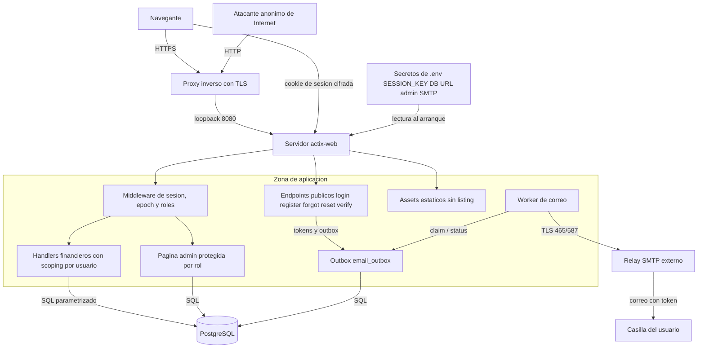

# Threat model — rfinance_app

Contexto validado con el dueño del servicio: la app se despliega **expuesta a
Internet detrás de un reverse proxy con TLS**, el **registro está abierto a
cualquiera** y los datos cargados son **finanzas personales reales** (producción
con HTTPS). Ese contexto sube la prioridad de fuerza bruta, enumeración y
gestión de la clave de sesión respecto a un despliegue puramente local.

## Executive summary

rfinance_app es un monolito actix-web con sesiones del lado cliente (cookie
cifrada+firmada con `SESSION_KEY`) y Postgres como único datastore. El control
de acceso está bien construido donde importa: todas las queries de dominio
filtran por `user_id`, los ids expuestos son UUID4 aleatorios y el frontend
arma el DOM con `textContent`. Los riesgos ya no están en la lógica de dominio
sino en el perímetro: fuerza bruta/stuffing y enumeración (hoy con rate limit
in-app y en el proxy de ejemplo), **`SESSION_KEY` estática sin rotación** cuya
fuga permite forjar sesiones admin, y el **perímetro de correo transaccional**:
registro y forgot pueden disparar mails, los enlaces de reset/verificación
llevan tokens, y las credenciales SMTP viven en `.env`. La sesión de 7 días
tiene revocación server-side al cambiar la contraseña (`session_epoch`), pero
logout sigue borrando solo la copia local. La amplificación por recurrencias
sigue acotada por cuotas y el snapshot por año, y ya hay logging/auditoría de
peticiones y mutaciones.

## Scope and assumptions

**In scope (runtime):** `src/main.rs` (bootstrap, middleware, servicios),
`src/middleware/` (sesión y roles), `src/routes/api/` (login, register, logout,
password_reset, email_verification, accounts, categories, transactions,
recurrences, snapshot), `src/routes/web/` (index, login, register, password
reset, verify email, admin), `src/mail/` (SMTP/log, outbox + worker, tokens y
plantillas), `templates/` (incluido `templates/email/`), `static/js/`,
`migrations/`, `deploy/nginx-rfinance.example.conf`, `.env.example`,
`Cargo.toml`/`Cargo.lock`.

**Out of scope:** los módulos `#[cfg(test)]` (conectan a la base real en
transacciones con rollback; no se ejecutan en producción), el tooling de
desarrollo (`sqlx-cli`, `skills-lock.json`, `.agents/`), el reverse proxy y su
TLS (infraestructura externa), el servidor PostgreSQL, **el relay SMTP y el
DNS del dominio** (la app confía en que entregan y firman lo que reciben; ver
supuestos), y las casillas de los usuarios.

**Supuestos (confirmados con el usuario):**

1. Exposición a Internet detrás de proxy con TLS terminado fuera de la app.
2. Registro abierto es intencional: multi-tenant público con datos reales.
3. Producción corre con HTTPS (se asume `APP_ENV=production`, ver preguntas
   abiertas).

**Supuestos adicionales (no confirmados):**

4. El proxy aplica (o va a aplicar) el `limit_req` del ejemplo
   `deploy/nginx-rfinance.example.conf`; la app además tiene su propio
   governor por IP. Si el proxy no lo aplica, la segunda capa no existe.
5. PostgreSQL escucha solo local; `.env` y el host no están comprometidos
   (si no, TM-002 y TM-015 pasan a activos).
6. Despliegue de un solo proceso (o varios workers del mismo binario) detrás
   del proxy; el claim del outbox usa `FOR UPDATE SKIP LOCKED`, así que varios
   workers no duplican envíos.
7. El relay SMTP autentica al remitente, firma con DKIM y entrega; el dominio
   tiene SPF/DKIM/DMARC publicados y alineados con `MAIL_FROM`.
8. Las casillas de los usuarios están fuera del control de la app: quien
   controle una casilla puede leer el token de reset/verificación que llegue.

**Preguntas abiertas que cambiarían el ranking:**

- ¿El proxy desplegado ya tiene `limit_req` sobre login, register, forgot,
  reset y resend?
- ¿En producción está efectivamente `APP_ENV=production`? (activa
  `cookie_secure`, `src/main.rs:37,43`; si queda `development`, la cookie viaja
  sin `Secure` por detrás del proxy).
- ¿`APP_URL` apunta a la URL pública HTTPS? Si queda en loopback, los links
  de reset/verificación no funcionan fuera del host y el flujo se rompe en
  silencio.
- ¿Los mails reales pasan SPF, DKIM y DMARC? (probar con "ver original" y
  mail-tester.com; si DKIM no firma, la entregabilidad cae).
- ¿El buzón SMTP es dedicado y su contraseña se rota? ¿Dónde viven
  `DATABASE_URL`, `SESSION_KEY`, `SMTP_PASS` y los backups (incluido
  `email_outbox`, que contiene tokens en claro hasta el envío)?

## System model

### Primary components

- **Servidor HTTP actix-web** (bind `127.0.0.1:8080`, `src/main.rs:84`) detrás
  de proxy con TLS. Un solo binario sirve HTML (askama), assets estáticos y
  JSON API.
- **Middleware de sesión**: `actix-session` con `CookieSessionStore` — la
  sesión completa (`user_email`, `user_id`, `user_epoch`, `user_role`) vive en
  la cookie, **cifrada y firmada** (contenido `Private` por defecto en
  actix-session 0.10, `config.rs:383`), TTL 7 días
  (`SessionMiddleware::session_ttl`), `HttpOnly` y `SameSite=Lax` por defecto,
  `Secure` solo si `APP_ENV=production`.
- **Guardias de authN/authZ**: `check_session` redirige a `/login` o responde
  401 para `/api/*` (`src/middleware/auth.rs`); los paths públicos incluyen
  login, register, forgot/reset/verify y assets. En cada request autenticado
  compara `user_epoch` del cookie contra `users.session_epoch`; el reset de
  contraseña sube el epoch y desaloja las sesiones previas. `GrantsMiddleware`
  extrae el rol de la sesión (`src/middleware/grants.rs:7-19`) y `/admin` usa
  `#[protect(any("Admin"))]` (`src/routes/web/admin.rs:15`).
- **Handlers de dominio financiero**: CRUD de cuentas, categorías,
  asientos y recurrencias (`src/routes/api/*.rs`), con resolución
  `public_id` UUID4 → id interno **filtrada por `user_id`** en cada query.
- **Correo transaccional**: `src/mail/` encapsula SMTP (lettre) o log,
  tokens de verificación/reset (32 bytes aleatorios, SHA-256 en DB, un solo
  uso) y el outbox `email_outbox` con su worker tokio en el mismo proceso.
  Los handlers de registro/reset solo encolan; el worker entrega con backoff.
- **PostgreSQL** vía sqlx (queries runtime parametrizadas; una macro
  `sqlx::query!` en `admin.rs:17` que exige base viva **en tiempo de build**).
- **Frontend vanilla JS**: `static/js/home.js` renderiza el snapshot del API
  construyendo el DOM con `createElement`/`textContent`; `templates/email/`
  arma los correos con askama.

### Data flows and trust boundaries

- Internet → proxy → **actix-web**: HTTP plano en el hop loopback (TLS lo
  termina el proxy). Datos: JSON de login/register/forgot/reset, cookies de
  sesión, HTML. Garantías: rate limit in-app por IP real en login, register,
  forgot, reset y resend; segunda capa en el ejemplo de nginx.
- Navegador → **app**: cookie de sesión cifrada+firmada. Garantías:
  confidencialidad e integridad dependen 100% de `SESSION_KEY`; el reset de
  contraseña invalida las sesiones vía `session_epoch`, pero logout sigue
  siendo local. TTL 7 días. No viaja `user_id` en JSON ni URLs.
- Cliente → **handlers JSON** (`web::Json`): tipado por serde
  (`TransactionInput`, `AccountInput`, `CategoryInput`). Validación por
  handler: fecha ISO con mes/día "posibles" pero **sin chequear día-mes real**
  (`transactions.rs:46-57`, acepta 31 de febrero), monto > 0 y finito,
  moneda ARS|USD; **sin límites de longitud** (los pone la DB → 500) ni
  política de contraseña en el API (`register.rs`).
- Handlers → **PostgreSQL**: sqlx con bind parametrizado en todas las
  queries (sin concatenación de strings); `DATABASE_URL` de `.env`;
  migraciones + `ensure_admin_user` al arranque (`src/main.rs:28-33,105`).
  Aislamiento multi-tenant por `WHERE user_id = $N` en cada query de dominio.
  El correo agrega `email_tokens` (hashes) y `email_outbox` (cuerpo del mail
  con token en claro hasta el envío).
- Worker → **relay SMTP** (TLS, 465/587): entrega los correos transaccionales
  con `SMTP_USER`/`SMTP_PASS`; el relay firma DKIM y entrega a la casilla. Es
  una frontera externa: la app no controla rebotes asíncronos, spam ni la
  lectura de la casilla.
- `.env` → **proceso al arranque**: `DATABASE_URL`, `ADMIN_USER`,
  `ADMIN_PASSWORD`, `SESSION_KEY` (≥32 bytes o pánico en `Key::from`,
  `cookie-0.16.2/src/secure/key.rs:62`), `MAIL_*`, `SMTP_*` y `APP_URL`
  (base de los links de verificación/reset; con `APP_ENV=production` es
  obligatoria).
- App → **assets estáticos** (`/css`, `/js`, `/fonts`, `/textures`): públicos
  sin sesión, sin directory listing (`src/main.rs`).

#### Diagram

## Assets and security objectives

| Asset | Why it matters | Security objective (C/I/A) |
|---|---|---|
| Registros financieros (`transactions`, `accounts`, `recurrences`, budgets) | Datos personales reales de dinero; la integridad del libro es el producto | C: solo el dueño; I: sin mutaciones no autorizadas; A: disponible |
| `SESSION_KEY` | Cifra+firma todas las sesiones; su fuga = forjar rol admin y cualquier `user_id` | C: confidencial; I: sin rotación no programada |
| Hashes bcrypt (`users.password`) y `ADMIN_PASSWORD` en `.env` | Puerta de authN; el admin es promovido en cada arranque (`main.rs:133-140`) | C |
| `DATABASE_URL` | Acceso directo a la base completa si se filtra | C |
| `SMTP_USER` / `SMTP_PASS` | Enviar como el dominio, dañar reputación y pescar credenciales; el buzón también recibe rebotes | C |
| Tokens de verificación/reset (`email_tokens.token_hash`) | Con el token en claro se toma la cuenta (reset) o se verifica un email ajeno | C; un solo uso y vencimiento |
| `email_outbox` (`to_email`, `body_text/html`) | PII + token en claro hasta que el mail se envía; crece sin límite si no hay retención | C |
| Reputación del dominio y entregabilidad (SPF/DKIM/DMARC) | Si se quema, los avisos de seguridad dejan de llegar | I/A |
| PII: email, nombre, apellido (`user_data`; columnas `ip`/`user_agent` existen pero nunca se pueblan) | Identidad y valor de phishing | C |
| Estado de autorización (`user_data.role`) | Único límite del perímetro `/admin` | I |
| Disponibilidad del proceso y del PostgreSQL compartido | Un solo binario; todos los tenants comparten la base | A |
| Trazabilidad (hoy inexistente) | Detección de abuso y forense de disputas de dinero | I/A |

## Attacker model

### Capabilities

- Acceso **no autenticado desde Internet** a: `POST /api/login`,
  `POST /api/register`, `POST /api/logout`, `POST /api/forgot-password`,
  `POST /api/reset-password`, `GET /forgot-password`, `/reset-password`,
  `/verify-email`, `/login`, `/register`, assets (`src/middleware/auth.rs`).
- **Registrarse ilimitadamente** (con rate limit por IP) y operar dentro de
  su tenant con JSON arbitrario (montos, fechas, longitudes,
  `installment_count`).
- **Disparar correos** a direcciones arbitrarias vía register (welcome) y
  forgot (reset), acotado por el rate limit por IP y el cooldown por usuario.
- Velocidad limitada: login 5/min, register 3/min, forgot 3/min, reset 5/min
  y resend 2/min por IP real, más la segunda capa del proxy.
- Si controla la **casilla de la víctima** (o un backup/logs con el mail):
  leer el token de reset/verificación y usarlo dentro de la ventana.
- Si obtiene un cookie válido (malware, logs de proxy mal configurados):
  replay hasta 7 días; el reset de contraseña de la víctima lo invalida vía
  `session_epoch`, pero el logout no.
- Si obtiene `.env` (backup, máquina de dev, compromiso del host): forjar
  sesiones de cualquier usuario incluido admin, y enviar correo como el
  dominio con las credenciales SMTP.

### Non-capabilities

- **No puede** hacer CSRF efectivo: `SameSite=Lax` (default actix-session),
  los endpoints mutantes exigen `Content-Type: application/json`
  (el extractor `web::Json` rechaza form-posts) y no hay headers CORS
  (preflight bloqueado).
- **No puede** leer ni alterar su cookie de sesión (cifrada y firmada,
  contenido `Private`).
- **No puede** forjar un token de verificación/reset: 32 bytes aleatorios
  (`getrandom`), solo se guarda el SHA-256, vence y es de un solo uso.
- **No puede** reutilizar un token de reset consumido ni usarlo después de
  la ventana (60 min reset, 48 h verificación).
- **No puede** inyectar headers de correo: los asuntos son estáticos y
  lettre rechaza CR/LF; `APP_URL` viene de `.env`, no del `Host`.
- **No puede** SQLi: todas las queries van con binds parametrizados.
- **No puede** IDOR/cross-tenant: cada query de dominio resuelve por
  `public_id` **y** `user_id` (p.ej. `transactions.rs:557-562`,
  `accounts.rs:137-142`); los UUID4 no son adivinables.
- **No puede** XSS hoy: el DOM se construye con `textContent`
  (`home.js:37-39`) y askama escapa `{{ email }}` (`templates/index.html:27`).
- No hay uploads, SSRF, eval, ni ejecución de subprocesos: superficie
  estructural mínima.

## Entry points and attack surfaces

| Surface | How reached | Trust boundary | Notes | Evidence (repo path / symbol) |
|---|---|---|---|---|
| `POST /api/login` | Internet (público) | Anónimo → App | 5/min por IP; bcrypt dummy para emails inexistentes | `src/routes/api/login.rs` |
| `POST /api/register` | Internet (público) | Anónimo → App | 3/min; enumera emails ("ya está registrado"); política de contraseña y email server-side | `src/routes/api/register.rs` |
| `POST /api/logout` | Internet (público) | Anónimo → App | Solo purga la cookie local | `src/routes/api/logout.rs` |
| `GET/POST /forgot-password`, `POST /api/forgot-password` | Internet (público) | Anónimo → App | 3/min; respuesta genérica 200; cooldown 2 min por usuario; token 60 min | `src/routes/web/password_reset.rs`; `src/routes/api/password_reset.rs` |
| `GET /reset-password`, `POST /api/reset-password` | Internet (público) | Anónimo → App | 5/min; token SHA-256 de un solo uso; sube `session_epoch` | `src/routes/api/password_reset.rs` |
| `GET /verify-email?token=…` | Internet (público) | Anónimo → App | Token 48 h de un solo uso; idempotente si ya está verificado | `src/routes/web/email_verification.rs` |
| `POST /api/resend-verification` | Sesión | User → App | 2/min por IP + cooldown 5 min por usuario | `src/routes/api/email_verification.rs` |
| `POST /admin/mail-test` | Sesión + rol Admin | Admin → App | Encola un mail solo a la casilla del admin logueado | `src/routes/web/admin.rs` |
| Worker app → relay SMTP | Salida a Internet | App → externo | TLS 465/587; outbox con backoff; el relay firma DKIM | `src/mail/transport.rs`; `src/mail/worker.rs` |
| `GET /api/snapshot` | Sesión | User → dominio | Devuelve TODO el libro del usuario, sin paginar | `src/routes/api/snapshot.rs:112-127` |
| `POST/PATCH/DELETE /api/accounts` `/api/categories` `/api/transactions` | Sesión | User → dominio | Validación parcial: NaN/habilidades de longitud → 500; `installment_count` sin rango | `accounts.rs:153-210`, `categories.rs:145-202`, `transactions.rs:520-604` |
| `DELETE /api/recurrences/{id}` | Sesión | User → dominio | Borra futuros según `entry_date > today` | `recurrences.rs:142-172` |
| `GET /` | Sesión | User → dominio | Materializa recurrencias en cada carga | `src/routes/web/home.rs:29-33` |
| `GET /admin` | Sesión + rol Admin | User → privilegiado | Niega con 404 (enmascara existencia) | `src/routes/web/admin.rs` |
| `/css`, `/js`, `/fonts`, `/textures`, favicons | Internet (público) | Público → filesystem | Sin directory listing | `src/main.rs` |

## Top abuse paths

1. **Stuffing → takeover de cuentas reales.** Obtené pares email/contraseña
   filtrados → spray contra `POST /api/login` (5/min por IP, sin lockout ni
   CAPTCHA; bcrypt cost 12 ≈ 250 ms CPU por intento, paralelizable) →
   con un par válido: `GET /api/snapshot` expone todas las finanzas de la
   víctima → `PATCH/DELETE` mutan o destruyen su libro. Efecto secundario:
   agotamiento de CPU del proceso (login se vuelve lento para todos).
2. **Robo de `SESSION_KEY` → admin forjado.** Conseguir una copia de `.env`
   (backup, máquina de dev, host comprometido) → fabricar la cookie cifrada
   `{user_id: cualquiera, user_role: "admin"}` → `/admin` + CRUD cross-tenant
   bajo cualquier `user_id`. No hay estado de sesión server-side que lo
   detecte ni revoque.
3. **Replay de cookie robada.** Exfiltrar el cookie de la víctima (malware,
   logs del proxy) → reusarlo hasta 7 días; el logout de la víctima
   (`session.purge()`) no lo desaloja, pero un reset de contraseña sí sube
   `session_epoch` y lo invalida en el siguiente request.
4. **DoS por inflado de la base compartida.** Registrar cuenta → repetir
   `POST /api/transactions` con `recurrence.installment_count: 32767`
   (≈32k filas insertadas por request, `recurrences.rs:79-126`) → `GET /`
   dispara `materialize` por carga y `GET /api/snapshot` relee todo sin
   paginar → disco/CPU compartidos degradan el servicio para todos los
   tenants.
5. **Enumeración → ataque dirigido.** Script de `POST /api/register` para
   mapear emails existentes (400 explícito) + timing de login (401 inmediato
   para emails inexistentes) → lista verificada → stuffing o phishing
   focalizado sobre cuentas con datos reales.
6. **Cuentas de contraseña débil.** Registrar directamente contra el API con
   contraseña vacía/corta (la única política vive en `register.js`, no en el
   server) → sin lockout, el brute force de esas cuentas es inmediato.
7. **Ruido de errores/panics.** JSON con 31-de-febrero, descripciones > 200
   chars, `opening_balance: NaN`, o carrera de email duplicado en register →
   `unwrap()/expect()` (`login.rs:24,29`, `register.rs:29-35`) → conexión
   cortada / 500; sin logs, difícil de diagnosticar.
8. **Regresión de self-XSS (futuro).** Si alguien introduce `innerHTML` con
   campos del snapshot en `home.js`, un `description` con HTML ejecuta en el
   navegador del propio dueño: el cookie es `HttpOnly` (no roba sesión) pero
   puede mutar finanzas por fetch same-origin. Hoy el impacto queda dentro
   del tenant propio (no hay vista admin que renderice datos de usuarios).
9. **Mail bombing / spam relámpago.** Un atacante usa `POST /api/register` o
   `POST /api/forgot-password` con el email de una víctima (o de terceros)
   para inundar su casilla o quemar la reputación del dominio. El rate limit
   por IP y el cooldown por usuario lo contienen; con IPs distribuidas queda
   un residual.
10. **Robo del enlace de reset.** Un atacante con acceso a la casilla de la
   víctima (o a un backup/log que contenga el mail) lee el token y cambia la
   contraseña. El token vence en 60 min, es de un solo uso y el cambio sube
   `session_epoch`; la víctima recibe el aviso `password_changed`.
11. **Abuso de credenciales SMTP.** Si se filtra `.env`, el atacante envía
   spam/phishing como el dominio, daña la reputación y puede recibir los
   rebotes del buzón. Mitigación: buzón dedicado, rotación, TLS obligatorio y
   `SMTP_TLS=none` bloqueado en producción.

## Threat model table

| Threat ID | Threat source | Prerequisites | Threat action | Impact | Impacted assets | Existing controls (evidence) | Gaps | Recommended mitigations | Detection ideas | Likelihood | Impact severity | Priority |
|---|---|---|---|---|---|---|---|---|---|---|---|---|
| TM-001 | Remoto anónimo | Exposición pública confirmada | Credential stuffing/fuerza bruta en `/api/login`; agotamiento de CPU por bcrypt | Toma de cuentas con contraseña reutilizada (finanzas reales); login degradado para todos | Credenciales, registros financieros, disponibilidad | bcrypt cost 12; mensajes 401 uniformes; rate limit in-app 5/min por IP real (`RealIpKeyExtractor`) + segunda capa en `deploy/nginx-rfinance.example.conf` | Sin lockout/CAPTCHA; un atacante con IPs distribuidas evade el límite; bcrypt cuesta CPU por intento | CAPTCHA tras N fallos; lockout suave por cuenta; alertas por fallos/minuto | Alerta por fallos/minuto por IP y por email; métricas de CPU del proceso | high | high | **high** |
| TM-002 | Entorno operativo (operador/dev) | Copia de `.env` (backup, máquina de dev, host) | Robar `SESSION_KEY` y forjar cookie `{user_role:"admin", user_id: cualquiera}` | Bypass total de authN/authZ incluido admin; CRUD cross-tenant | `SESSION_KEY`, registros financieros, estado de autorización | Cookie cifrada+firmada (default `Private`, actix-session 0.10); `.env` en `.gitignore` | Clave estática sin rotación; `user_id`/rol se confían 100% al cookie; sin detección de abuso | Documentar spec exacta de `SESSION_KEY` (≥32 bytes crudos); rotar ante sospecha (loguea a todos); mover a secret manager; revalidar rol desde DB en rutas sensibles | Alertas sobre tráfico admin inusual; monitorear accesos a `.env` | medium | high | **high** |
| TM-003 | Endpoint de la víctima comprometido | Exfiltración del cookie (malware, logs de proxy) | Replay del cookie durante hasta 7 días | Acceso persistente a la cuenta pese a logout | Sesiones, registros financieros | `HttpOnly` + `SameSite=Lax` (defaults); `Secure` en producción; TLS en el proxy; `session_epoch` invalida todas las sesiones al resetear contraseña | TTL 7 días; logout solo purga la copia local; no hay revocación por sesión individual | Store server-side si se necesita revocación fina; runbook de incidente (rotar `SESSION_KEY` = kick all) | Alerta por uso concurrente desde IPs/geos distintas; velocidad anómala de API | medium | high | medium |
| TM-004 | Tenant autoregistrado | Registro abierto (confirmado) | Inflar la base: POST con recurrencia `installment_count` máximo (≈32k filas/request) + snapshot sin paginar + `materialize` por carga de `/` | Degradación del servicio compartido; costo de disco/CPU | Disponibilidad, PostgreSQL | CHECKs de schema (`finanzas.up.sql`); `materialize` idempotente por cursor | `installment_count` sin rango (i16 crudo, `transactions.rs:180`); sin cuotas por usuario; snapshot sin LIMIT | Validar rango de `installment_count` (p.ej. 1..=1200); acotar filas por llamada de `materialize`; paginar/filtrar snapshot por mes; rate limits en el proxy | Alerta por crecimiento de filas por usuario; monitorear tamaño de tabla y conexiones | medium | medium | medium |
| TM-005 | Remoto anónimo | Ninguna (registro público) | Registrar con contraseña vacía/débil directamente contra el API (la política vive solo en `register.js`) | Cuentas trivialmente forzables; combina con TM-001 | Credenciales, sesiones | bcrypt al registrar (`register.rs:27`) | Sin política server-side; sin validación de formato de email; bcrypt trunca a 72 bytes en silencio | Exigir longitud mínima (p.ej. ≥10) y rechazar >72 bytes en `/api/register`; validar formato de email; devolver 400 claros | Registrar métricas de registros con contraseñas débiles | medium | medium | medium |
| TM-006 | Remoto anónimo | Ninguna | Enumerar emails vía mensaje explícito de register + timing de login/forgot | Listas de emails verificadas para stuffing/phishing dirigido | PII | 401 uniforme y bcrypt dummy en login; register revela existencia por decisión de producto; forgot responde 200 genérico con rate limit 3/min y cooldown 2 min | El camino de forgot con email existente hace inserts/template y el inexistente no: timing medible; register sigue siendo un oráculo explícito | Igualar el trabajo del camino inexistente (hash/insert dummy) o aceptar el residual por rate limit; mensaje genérico en register si el producto lo permite | Correlacionar ráfagas de register/forgot con fallos de login | high | low | low |
| TM-007 | Habilitador de TM-001/TM-004 | Que cualquier abuso esté en curso | Abuso sin trazabilidad suficiente | Abuso prolongado sin detección; sin forense en disputas | Trazabilidad, registros financieros | Logger de actix + middleware `AUDIT` con user_id para mutaciones de `/api/`; logs de errores del worker/outbox | Logs locales por defecto; no hay alertas ni retención off-host definida en el repo | Enviar logs off-host; alertar por tasa de 5xx, fallos de login y `email_outbox.failed` | Alertas de 5xx/401/429 y de outbox fallido | medium | medium | medium |
| TM-008 | Remoto (auth o anónimo) | JSON craft | Fechas imposibles, strings sobre el largo VARCHAR, NaN/∞ en balances, carrera de email duplicado → panics/500 | Resets de conexión; DoS ruidoso; señal de errores | Disponibilidad | Constraints de DB como backstop (`finanzas.up.sql`) | Validación API incompleta (`is_valid_date` acepta 31/02; sin límites de largo ni finitud); `unwrap()/expect()` en handlers (`login.rs:24`, `register.rs:20,35`) | Validar largo (descripción ≤200, nombres ≤100/60), día-mes real (reusar `last_day_of_month`), finitud de montos → 400; reemplazar unwrap/expect por 500 controlados | Tasa de 5xx y panics en logs | medium | low | low |
| TM-009 | Regresión de desarrollo | Que alguien introduzca `innerHTML` con datos del snapshot | Self-XSS dentro del tenant (descripciones/nombres son strings del usuario) | Hoy: mutación same-origin en la sesión del propio dueño (cookie `HttpOnly`); crecería si una vista admin renderiza datos de usuarios | Integridad de sesión, registros | DOM con `createElement`/`textContent` (`home.js:37-39`); askama escapa `{{ email }}` | Sin CSP como segunda capa; ya hay `innerHTML` usados para limpiar (`home.js:145,190,331`) | Agregar CSP `default-src 'self'` + `frame-ancestors` + `nosniff` vía middleware de headers; lint que prohíba `innerHTML` con variables | Reportes de violación de CSP | low | low | low |
| TM-010 | Remoto anónimo | Ninguna | Enumerar nombres de assets si hubiera listing | Divulgación trivial de nombres de archivos de assets | Info pública-ish | Directory listing eliminado en `/css` y `/js`; actix-files protege path traversal | Los nombres siguen siendo adivinables si se filtran | Mantener `Files` sin listing y no subir secretos a `static/` | Revisar access log | low | low | low |
| TM-011 | Sitio de terceros controlado por atacante | Víctima con sesión activa | CSRF sobre endpoints mutantes | Cambio de estado como la víctima | Integridad de sesión | `SameSite=Lax` default (actix-session `config.rs:385`); `web::Json` exige `application/json`; sin headers CORS (preflight bloqueado) | Postura implícita, no documentada; sin verificación de `Origin` | Documentar la postura CSRF; opcional: chequear `Sec-Fetch-Site: same-origin` en mutantes como defensa extra | Log de 403 por origin cruzado | low | low | low |
| TM-012 | Entorno de build/CI | `sqlx::query!` en `admin.rs:17` exige DB viva en build | `DATABASE_URL` (con credenciales de base) presente en máquinas de build | Credenciales con ataque en entornos de build | `DATABASE_URL`, supply chain | `Cargo.lock` con versiones fijadas; `.env` fuera de git; cache `.sqlx` offline commiteada (`SQLX_OFFLINE=true` funciona) | La cache puede quedar vieja tras cambiar el query o el esquema; regenerarla exige DB | Regenerar `.sqlx` al tocar `admin.rs`/migraciones; CI con `SQLX_OFFLINE=true` | Auditar quién accede a `DATABASE_URL` en CI | low | low | low |
| TM-013 | Remoto anónimo / distribuido | Registro y forgot públicos | Disparar correos a una víctima o a terceros vía register/forgot | Inundación de casillas, quema de reputación, costo del relay | Reputación, disponibilidad del correo | Rate limit 3/min por IP en register/forgot; cooldown 2 min por usuario; verificación con token | Sin CAPTCHA; IPs distribuidas evaden el límite por IP; register acepta cualquier email | CAPTCHA tras N fallos; límite por email destino; doble opt-in en register | Alertas por picos de outbox y rebotes; ratio envíos/registros | medium | medium | medium |
| TM-014 | Atacante con acceso a la casilla, backups o logs | Mail de reset/verificación | Leer el token del enlace y usarlo | Toma de cuenta (reset) o verificación fraudulenta | Cuenta, sesiones, PII | Token 32 B (`getrandom`), SHA-256 en DB, 60 min/48 h, un solo uso, invalida tokens previos; reset sube epoch y envía aviso | El token viaja en claro por correo y queda en `email_outbox` hasta el envío; una casilla/backup comprometido tiene ventana | Retención corta del outbox; no loguear cuerpos; buzón dedicado; alertar reset desde IP nueva | Reset exitoso desde IP/UA nueva; revisar outbox | low | high | medium |
| TM-015 | Entorno operativo / atacante con `.env` | `SMTP_PASS` filtrado | Enviar spam/phishing como el dominio; leer rebotes | Reputación, entregabilidad, PII de rebotes | Credenciales SMTP, reputación | `.env` gitignored; TLS obligatorio; `SMTP_TLS=none` bloqueado en producción; no se loguean credenciales | Contraseña estática sin rotación; buzón compartido con la casilla personal | Buzón dedicado; rotación; permisos mínimos; monitorear AUTH fallida y volumen | Alertas del proveedor/DMARC; tasa de envíos | low | high | medium |
| TM-016 | Remoto anónimo | `POST /api/forgot-password` público | Medir tiempo para saber si el email existe | Listas de emails para phishing/stuffing | PII | Respuesta 200 genérica; 3/min por IP; cooldown 2 min por usuario | El camino existente hace inserts/template y el inexistente no: timing medible | Igualar el trabajo del camino inexistente (hash/insert dummy) o aceptar el residual por rate limit | Correlacionar ráfagas de forgot con logins fallidos | medium | low | low |
| TM-017 | Regresión operativa / backups | Datos acumulados | `email_outbox`/`email_tokens` conservan PII y tokens vencidos indefinidamente | Exposición en backups/consultas | PII, tokens | `email_tokens` guarda solo el hash; el outbox se marca sent/failed | Sin job de retención; el outbox crece con `to_email` y cuerpos | Purgar outbox > 30 días y tokens usados/vencidos > 7; higiene de backups | Tamaño y antigüedad máxima de tablas | medium | low | low |
| TM-018 | Remoto / falla de DB | Cualquier request autenticado | El middleware consulta `users.session_epoch` por request; DB lenta/caída → 500 o latencia | Degradación/DoS de disponibilidad | Disponibilidad | Fail-closed; query por PK; pool con timeouts | Un round-trip extra por request, sin caché | Cachear el epoch con TTL corto o validar solo en rutas sensibles si crece la latencia | Latencia DB y tasa de 5xx | low | medium | low |
| TM-019 | Escáner de correo / prefetch | Link GET de verificación | Consumir el token antes de que el usuario haga click | Verificación no intencional del flag | Integridad de verificación | Verificación idempotente; solo afecta `email_verified_at`; el reset consume solo por POST | El GET de verificación muta estado | Aceptar (es el objetivo del flujo) o confirmar con POST; el reset ya es POST | — | low | low | low |

## Criticality calibration

Para **este** repo y su contexto (Internet + registro abierto + dinero real):

- **critical**: `SESSION_KEY` filtrada y explotada activamente para forjar
  sesiones admin (TM-002); exfiltración cross-tenant de registros
  financieros a escala; RCE pre-auth (no existe superficie hoy: sin uploads,
  sin eval, sin subprocess).
- **high**: stuffing exitoso sobre cualquier cuenta con datos reales y
  derecho a mutar el libro (TM-001); agotamiento de CPU por bcrypt que deja
  el login inutilizable para todos (TM-001); replay de cookie hasta que la
  víctima resetee la contraseña (TM-003 en su peor caso).
- **medium**: inflado de la base compartida que degrada a todos los tenants
  (TM-004); auditoría sin alertas que prolonga cualquier abuso (TM-007);
  contraseñas vacías/débiles aceptadas server-side (TM-005); mail bombing
  (TM-013); robo del enlace de reset (TM-014); abuso de credenciales SMTP si
  se filtra `.env` (TM-015).
- **low**: 500s/panics por request (TM-008); enumeración de emails sola
  (TM-006); residual de CSRF (TM-011), self-XSS (TM-009), timing de forgot
  (TM-016), retención de outbox/tokens (TM-017), coste del epoch por request
  (TM-018) y prefetch de verificación (TM-019).

## Focus paths for security review

| Path | Why it matters | Related Threat IDs |
|---|---|---|
| `src/routes/api/login.rs` | Superficie de fuerza bruta, oráculo de timing y `unwrap()` que paniquea | TM-001, TM-006, TM-008 |
| `src/routes/api/register.rs` | Enumeración, política de contraseña server-side, carrera de email único y creación de token+outbox | TM-005, TM-006, TM-008, TM-013 |
| `src/routes/api/password_reset.rs` | Emisión/consumo de tokens, epoch de sesión y aviso de contraseña cambiada | TM-003, TM-014, TM-016 |
| `src/routes/api/email_verification.rs` | Reenvío de verificación, cooldown y emisión de tokens | TM-013, TM-014 |
| `src/routes/web/email_verification.rs` | Consumo del token de verificación (GET que muta estado) | TM-014, TM-019 |
| `src/routes/web/password_reset.rs` | Validación previa del token y render de la página de reset | TM-014 |
| `src/mail/transport.rs` | TLS/credenciales SMTP, límites de configuración y formato de los headers | TM-014, TM-015 |
| `src/mail/worker.rs` | Claim/reintentos del outbox; cola compartida entre workers | TM-013, TM-017 |
| `src/mail/token.rs` | Aleatoriedad y hashing de tokens | TM-014 |
| `templates/email/` | Links de reset/verificación, escaping y copy del correo | TM-014 |
| `src/main.rs` | Config de sesión (TTL/Secure/clave), governors de correo, bootstrap del worker | TM-002, TM-003, TM-007 |
| `src/middleware/auth.rs` | Lista de paths públicos y validación de `session_epoch` en cada request | TM-001, TM-003, TM-006, TM-018 |
| `src/middleware/grants.rs` + `src/routes/web/admin.rs` | Cadena authZ completa: rol firmado en sesión → `#[protect]`; mail-test | TM-002 |
| `src/routes/api/recurrences.rs` (`materialize`) | Bucle de amplificación: cuántas filas puede insertar un request | TM-004 |
| `src/routes/api/transactions.rs` | Validación de fecha realista, largos y rango de `installment_count` | TM-004, TM-008 |
| `src/routes/api/snapshot.rs` | Lectura completa sin paginar por cada carga del dashboard | TM-004 |
| `src/routes/api/accounts.rs`, `categories.rs` | NaN/oversize en balances y límites → 500 en vez de 400 | TM-008 |
| `static/js/home.js` | Patrón DOM-safe actual + puntos donde un futuro `innerHTML` abriría self-XSS | TM-009 |
| `migrations/20261123120000_email.up.sql` | Tokens, outbox, `email_verified_at` y `session_epoch` | TM-014, TM-017 |
| `migrations/20261015015255_finanzas.up.sql` | Backstop de constraints (VARCHAR/CHECK) que hoy convierte inputs inválidos en 500 | TM-004, TM-008 |
| `deploy/nginx-rfinance.example.conf` | Segunda capa de rate limit para login/register/forgot/reset/resend | TM-001, TM-013, TM-016 |
| `.env.example` + `AGENTS.md` | Secretos (`SESSION_KEY`, SMTP), `APP_URL` y guía de generación | TM-002, TM-015 |

## Notes on use

- Los supuestos que más mueven el ranking: (1) exposición pública confirmada;
  (2) el proxy aplica o no la segunda capa de `limit_req` — si no, TM-001 y
  TM-013 suben; (3) `APP_ENV=production` efectivo en prod — si no, la cookie
  pierde `Secure` y TM-003 sube; (4) host/`.env` sanos — si no, TM-002 y
  TM-015 son activos; (5) el relay SMTP firma DKIM y entrega — si no, los
  avisos de seguridad no llegan y el flujo de reset se rompe.
- Revisitar este modelo si: se agrega una vista admin que renderice datos de
  usuarios (sube TM-009), se agregan rutas públicas nuevas (revisar
  `is_public_path`), se cambia a sessions server-side (baja TM-002/TM-003), se
  agregan uploads/integraciones externas, se agrega un webhook de rebotes
  (nuevo entry point), o el volumen de correo deja de ser transaccional (sube
  TM-013/TM-017).
- Evidencia anclada a commits actuales de la rama de trabajo; los números de
  línea pueden correr con refactors menores.

## Mitigations implemented (2026-10-20)

Plan de mitigación ejecutado (ver `SECURITY.md` y el ejemplo de proxy en
`deploy/`). Cobertura por amenaza:

| TM | Mitigación implementada | Evidencia |
|---|---|---|
| TM-001 | Rate limit in-app 5/min por IP real en login + logging de fallos | `src/main.rs` (actix-governor, `RealIpKeyExtractor`); segunda capa: `deploy/nginx-rfinance.example.conf` |
| TM-002 | `SESSION_KEY` validada al arranque con mensaje accionable; rol de `/admin` revalidado contra la DB; runbook de rotación | `src/main.rs`; `src/routes/web/admin.rs`; `SECURITY.md` |
| TM-003 | TTL de sesión 27 → 7 días; `APP_ENV=production` en checklist de despliegue | `src/main.rs`; `SECURITY.md` |
| TM-004 | Cuotas 1..=600; tope de 120 inserts por `materialize` por llamada; snapshot por año (`?year=`) con LIMIT 5000; rate limit en register | `src/routes/api/transactions.rs`; `src/routes/api/recurrences.rs`; `src/routes/api/snapshot.rs` |
| TM-005 | Política de contraseña (10..=72 bytes) y validación de email server-side; espejo client-side | `src/routes/api/register.rs`; `static/js/register.js` |
| TM-006 | bcrypt dummy para emails inexistentes (timing uniforme); mensaje de register conservado por decisión de producto | `src/routes/api/login.rs` |
| TM-007 | `Logger` de actix + middleware `AUDIT` con user_id para mutaciones de `/api/` | `src/main.rs`; `src/middleware/audit.rs` |
| TM-008 | Fechas con día real (31/02 → 400, además fix de panic con multibyte); largos y finitud de montos server-side; `unwrap`/`expect` fuera de handlers; carrera de email → 400 | `transactions.rs` (`is_valid_date`), `accounts.rs`, `categories.rs`, `login.rs`, `register.rs` |
| TM-009 | CSP `default-src 'self'; frame-ancestors 'none'` + `nosniff` + `X-Frame-Options` + `Referrer-Policy`; script inline de admin.html extraído a `/js/admin.js`; estilos inline de login/register a clases CSS | `src/middleware/headers.rs`; `templates/*`; `static/css/style.css` |
| TM-010 | Directory listing eliminado de `/css` y `/js` | `src/main.rs` |
| TM-011 | Postura CSRF documentada como requisito de repo (mutantes solo `web::Json` + SameSite=Lax) | `SECURITY.md` |
| TM-012 | Cache `.sqlx` offline generada y commiteada; builds sin DB (`SQLX_OFFLINE=true`) | `.sqlx/`; `AGENTS.md` |

Smoke test E2E verificado contra la base local: headers en 302/200, listing
404, 5 logins/min por IP (6to → 429), validaciones de register/asientos en
400, snapshot por año, `/admin` en 404 para rol user, `AUDIT` con `user_id`
en mutaciones autenticadas, y serie de 600 cuotas con `generated: 120`
(corte por llamada activo).

## Mitigations implemented (2026-11-23)

Correo transaccional, revocación de sesión al resetear contraseña y tests de
integración:

| TM | Mitigación implementada | Evidencia |
|---|---|---|
| TM-003 | `users.session_epoch` validado en cada request autenticado; el reset de contraseña sube el epoch y cierra las demás sesiones | `migrations/20261123120000_email.up.sql`; `src/middleware/auth.rs`; `src/routes/api/password_reset.rs` |
| TM-006 | `forgot-password` responde 200 genérico, con rate limit 3/min y cooldown 2 min por usuario; el timing residual queda documentado | `src/routes/api/password_reset.rs`; `src/main.rs` |
| TM-007 | El worker del outbox loguea fallos y guarda `last_error` en la DB | `src/mail/worker.rs` |
| TM-013 | Rate limits in-app + ejemplo de nginx para forgot/reset/resend; cooldown por usuario en forgot y resend | `src/main.rs`; `deploy/nginx-rfinance.example.conf` |
| TM-014 | Tokens de 32 B (`getrandom`), SHA-256 en DB, un solo uso, TTL 60 min/48 h e invalidación de tokens previos | `src/mail/token.rs`; `migrations/20261123120000_email.up.sql`; `src/routes/api/password_reset.rs` |
| TM-015 | TLS obligatorio (wrapper/starttls), `SMTP_TLS=none` rechazado con `APP_ENV=production`, `MAIL_FROM` obligatorio en modo smtp, credenciales nunca logueadas | `src/mail/transport.rs` |
| TM-016 | Respuesta genérica en forgot; cooldown y rate limit como contención (timing residual aceptado) | `src/routes/api/password_reset.rs` |
| TM-017 | `email_tokens` guarda solo el hash; el outbox expone estado `pending/sending/sent/failed` (la purga queda como tarea operativa) | `migrations/20261123120000_email.up.sql`; `src/mail/worker.rs` |
| TM-018 | El middleware falla cerrado y consulta el epoch por PK; si la DB no responde, 500 controlado | `src/middleware/auth.rs` |
| TM-019 | La verificación es idempotente; el reset consume el token solo por POST | `src/routes/web/email_verification.rs`; `src/routes/api/password_reset.rs` |

Tests: **42 en verde** (12 nuevos de integración con transacción + rollback
para reset, verificación y outbox) y `cargo clippy --all-targets -- -D
warnings` limpio. Los tests de DB siguen el patrón del repo (`#[sqlx::test]`
no es viable porque el rol no tiene `CREATEDB`).

Smoke test del correo: `POST /admin/mail-test` entregado a una casilla real
por SMTP 465 con TLS; los flujos de bienvenida, verificación y reset se
probaron con un usuario descartable (en modo `log` y con SMTP real, por el
dueño), incluyendo cookie vieja → 401, token reusado → 400, cooldown → 429
y already-verified → 400. El bloque `limit_req` nuevo de nginx está en el
ejemplo del repo: **falta replicarlo en el servidor**.
