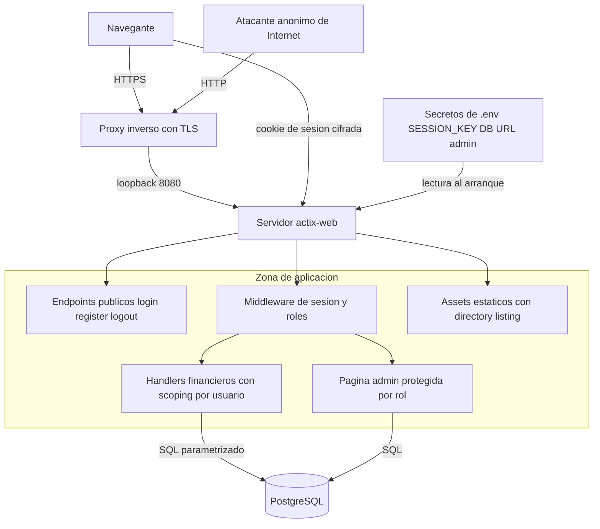

# Threat model — rfinance_app

Contexto validado con el dueño del servicio: la app se despliega **expuesta a
Internet detrás de un reverse proxy con TLS**, el **registro está abierto a
cualquiera** y los datos cargados son **finanzas personales reales** (producción
con HTTPS). Ese contexto sube la prioridad de fuerza bruta, enumeración y
gestión de la clave de sesión respecto a un despliegue puramente local.

## Executive summary

rfinance_app es un monolito actix-web con sesiones del lado cliente (cookie
cifrada+firmada con `SESSION_KEY`) y Postgres como único datastore. El control
de acceso está bien construido donde importa: todas las queries de dominio
filtran por `user_id`, los ids expuestos son UUID4 aleatorios y el frontend
arma el DOM con `textContent`. Los riesgos principales no están en la lógica de
dominio sino en el perímetro: **no existe rate limiting** en `/api/login`
(fuerza bruta/stuffing + agotamiento de CPU por bcrypt) ni en
`/api/register` (enumeración de emails y crecimiento de tenants);
**`SESSION_KEY` es un secreto estático sin rotación** cuya fuga permite
forjar sesiones admin; y la sesión de 27 días **no tiene revocación del lado
servidor** (logout solo borra la copia del cliente). Además hay un vector de
amplificación de recursos: un solo POST con recurrencia
`installment_count: 32767` inserta ~32k filas, y el snapshot devuelve el libro
completo sin paginar. No hay logging de peticiones ni auditoría alguna, lo que
hace que cualquier abuso anterior sea indetectable.

## Scope and assumptions

**In scope (runtime):** `src/main.rs` (bootstrap, middleware, servicios),
`src/middleware/` (sesión y roles), `src/routes/api/` (login, register, logout,
accounts, categories, transactions, recurrences, snapshot),
`src/routes/web/` (index, login, register, admin), `static/js/` (render
client-side), `templates/`, `migrations/`, `.env.example`, `Cargo.toml`/`Cargo.lock`.

**Out of scope:** los módulos `#[cfg(test)]` (conectan a la base real en
transacciones con rollback; no se ejecutan en producción), el tooling de
desarrollo (`sqlx-cli`, `skills-lock.json`, `.agents/`), el reverse proxy y su
TLS (infraestructura externa), y la configuración del servidor PostgreSQL.

**Supuestos (confirmados con el usuario):**

1. Exposición a Internet detrás de proxy con TLS terminado fuera de la app.
2. Registro abierto es intencional: multi-tenant público con datos reales.
3. Producción corre con HTTPS (se asume `APP_ENV=production`, ver preguntas
   abiertas).

**Supuestos adicionales (no confirmados):**

4. El proxy **no** aplica rate limiting/WAF relevante (si lo aplica, TM-001
   baja a Medium).
5. PostgreSQL escucha solo local; `.env` y el host no están comprometidos
   (si no, TM-002 pasa a Critical activo).
6. Despliegue de un solo proceso (o varios workers del mismo binario) detrás
   del proxy; no hay cachés ni workers extra.

**Preguntas abiertas que cambiarían el ranking:**

- ¿El proxy aplica `limit_req`/WAF sobre `/api/login` y `/api/register`?
- ¿En producción está efectivamente `APP_ENV=production`? (activa
  `cookie_secure`, `src/main.rs:37,43`; si queda `development`, la cookie viaja
  sin `Secure` por detrás del proxy).
- ¿Hay backups de Postgres y dónde viven `DATABASE_URL`/`SESSION_KEY` además
  del `.env` del servidor (máquinas de dev, CI)?

## System model

### Primary components

- **Servidor HTTP actix-web** (bind `127.0.0.1:8080`, `src/main.rs:84`) detrás
  de proxy con TLS. Un solo binario sirve HTML (askama), assets estáticos y
  JSON API.
- **Middleware de sesión**: `actix-session` con `CookieSessionStore` — la
  sesión completa (`user_email`, `user_id`, `user_role`) vive en la cookie,
  **cifrada y firmada** (contenido `Private` por defecto en actix-session
  0.10, `config.rs:383`), TTL 27 días (`src/main.rs:44-47`), `HttpOnly` y
  `SameSite=Lax` por defecto, `Secure` solo si `APP_ENV=production`.
- **Guardias de authN/authZ**: `check_session` redirige a `/login` o responde
  401 para `/api/*` (`src/middleware/auth.rs:24-76`); `GrantsMiddleware`
  extrae el rol de la sesión (`src/middleware/grants.rs:7-19`) y `/admin` usa
  `#[protect(any("Admin"))]` (`src/routes/web/admin.rs:15`).
- **Handlers de dominio financiero**: CRUD de cuentas, categorías,
  asientos y recurrencias (`src/routes/api/*.rs`), con resolución
  `public_id` UUID4 → id interno **filtrada por `user_id`** en cada query.
- **PostgreSQL** vía sqlx (queries runtime parametrizadas; una macro
  `sqlx::query!` en `admin.rs:17` que exige base viva **en tiempo de build**).
- **Frontend vanilla JS**: `static/js/home.js` renderiza el snapshot del API
  construyendo el DOM con `createElement`/`textContent`.

### Data flows and trust boundaries

- Internet → proxy → **actix-web**: HTTP plano en el hop loopback (TLS lo
  termina el proxy). Datos: JSON de login/register, cookies de sesión, HTML.
  Garantías: ninguna validación de origen/volumen en la app; sin rate limit
  propio (`src/main.rs` no registra límites).
- Navegador → **app**: cookie de sesión cifrada+firmada. Garantías:
  confidencialidad e integridad dependen 100% de `SESSION_KEY`; no hay
  revocación server-side; TTL 27 días. No viaja `user_id` en JSON ni URLs.
- Cliente → **handlers JSON** (`web::Json`): tipado por serde
  (`TransactionInput`, `AccountInput`, `CategoryInput`). Validación por
  handler: fecha ISO con mes/día "posibles" pero **sin chequear día-mes real**
  (`transactions.rs:46-57`, acepta 31 de febrero), monto > 0 y finito,
  moneda ARS|USD; **sin límites de longitud** (los pone la DB → 500) ni
  política de contraseña en el API (`register.rs`).
- Handlers → **PostgreSQL**: sqlx con bind parametrizado en todas las
  queries (sin concatenación de strings); `DATABASE_URL` de `.env`;
  migraciones + `ensure_admin_user` al arranque (`src/main.rs:28-33,105`).
  Aislamiento multi-tenant por `WHERE user_id = $N` en cada query de dominio.
- `.env` → **proceso al arranque**: `DATABASE_URL`, `ADMIN_USER`,
  `ADMIN_PASSWORD`, `SESSION_KEY` (≥32 bytes o pánico en `Key::from`,
  `cookie-0.16.2/src/secure/key.rs:62`).
- App → **assets estáticos** (`/css`, `/js`, `/fonts`, `/textures`): públicos
  sin sesión, con **directory listing** en `/css` y `/js`
  (`src/main.rs:77-78`).

#### Diagram

## Assets and security objectives

| Asset | Why it matters | Security objective (C/I/A) |
|---|---|---|
| Registros financieros (`transactions`, `accounts`, `recurrences`, budgets) | Datos personales reales de dinero; la integridad del libro es el producto | C: solo el dueño; I: sin mutaciones no autorizadas; A: disponible |
| `SESSION_KEY` | Cifra+firma todas las sesiones; su fuga = forjar rol admin y cualquier `user_id` | C: confidencial; I: sin rotación no programada |
| Hashes bcrypt (`users.password`) y `ADMIN_PASSWORD` en `.env` | Puerta de authN; el admin es promovido en cada arranque (`main.rs:133-140`) | C |
| `DATABASE_URL` | Acceso directo a la base completa si se filtra | C |
| PII: email, nombre, apellido (`user_data`; columnas `ip`/`user_agent` existen pero nunca se pueblan) | Identidad y valor de phishing | C |
| Estado de autorización (`user_data.role`) | Único límite del perímetro `/admin` | I |
| Disponibilidad del proceso y del PostgreSQL compartido | Un solo binario; todos los tenants comparten la base | A |
| Trazabilidad (hoy inexistente) | Detección de abuso y forense de disputas de dinero | I/A |

## Attacker model

### Capabilities

- Acceso **no autenticado desde Internet** a: `POST /api/login`,
  `POST /api/register`, `POST /api/logout`, `/login`, `/register`, assets
  (`src/middleware/auth.rs:11-22`).
- **Registrarse ilimitadamente** y operar dentro de su tenant con JSON
  arbitrario (montos, fechas, longitudes, `installment_count` i16).
- Velocidad no acotada: ningún endpoint aplica rate limit ni lockout.
- Si obtiene un cookie válido (malware, logs de proxy mal configurados):
  replay durante hasta 27 días.
- Si obtiene `.env` (backup, máquina de dev, compromiso del host): forjar
  sesiones de cualquier usuario incluido admin.

### Non-capabilities

- **No puede** hacer CSRF efectivo: `SameSite=Lax` (default actix-session),
  los endpoints mutantes exigen `Content-Type: application/json`
  (el extractor `web::Json` rechaza form-posts) y no hay headers CORS
  (preflight bloqueado).
- **No puede** leer ni alterar su cookie de sesión (cifrada y firmada,
  contenido `Private`).
- **No puede** SQLi: todas las queries van con binds parametrizados.
- **No puede** IDOR/cross-tenant: cada query de dominio resuelve por
  `public_id` **y** `user_id` (p.ej. `transactions.rs:557-562`,
  `accounts.rs:137-142`); los UUID4 no son adivinables.
- **No puede** XSS hoy: el DOM se construye con `textContent`
  (`home.js:37-39`) y askama escapa `{{ email }}` (`templates/index.html:27`).
- No hay uploads, SSRF, eval, ni ejecución de subprocesos: superficie
  estructural mínima.

## Entry points and attack surfaces

| Surface | How reached | Trust boundary | Notes | Evidence (repo path / symbol) |
|---|---|---|---|---|
| `POST /api/login` | Internet (público) | Anónimo → App | Sin rate limit; timing diferencia emails existentes | `src/routes/api/login.rs:13-52` |
| `POST /api/register` | Internet (público) | Anónimo → App | Enumera emails ("ya está registrado"); sin política de contraseña ni formato de email | `src/routes/api/register.rs:14-45` |
| `POST /api/logout` | Internet (público) | Anónimo → App | Solo purga la cookie local | `src/routes/api/logout.rs:4-8` |
| `GET /api/snapshot` | Sesión | User → dominio | Devuelve TODO el libro del usuario, sin paginar | `src/routes/api/snapshot.rs:112-127` |
| `POST/PATCH/DELETE /api/accounts` `/api/categories` `/api/transactions` | Sesión | User → dominio | Validación parcial: NaN/habilidades de longitud → 500; `installment_count` sin rango | `accounts.rs:153-210`, `categories.rs:145-202`, `transactions.rs:520-604` |
| `DELETE /api/recurrences/{id}` | Sesión | User → dominio | Borra futuros según `entry_date > today` | `recurrences.rs:142-172` |
| `GET /` | Sesión | User → dominio | Materializa recurrencias en cada carga | `src/routes/web/home.rs:29-33` |
| `GET /admin` | Sesión + rol Admin | User → privilegiado | Niega con 404 (enmascara existencia) | `src/routes/web/admin.rs:14-28` |
| `/css`, `/js` (con listing), `/fonts`, `/textures`, favicons | Internet (público) | Público → filesystem | `show_files_listing` en css y js | `src/main.rs:77-81` |

## Top abuse paths

1. **Stuffing → takeover de cuentas reales.** Obtené pares email/contraseña
   filtrados → spray contra `POST /api/login` (sin rate limit, sin lockout,
   sin logs; bcrypt cost 12 ≈ 250 ms CPU por intento, paralelizable) →
   con un par válido: `GET /api/snapshot` expone todas las finanzas de la
   víctima → `PATCH/DELETE` mutan o destruyen su libro. Efecto secundario:
   agotamiento de CPU del proceso (login se vuelve lento para todos).
2. **Robo de `SESSION_KEY` → admin forjado.** Conseguir una copia de `.env`
   (backup, máquina de dev, host comprometido) → fabricar la cookie cifrada
   `{user_id: cualquiera, user_role: "admin"}` → `/admin` + CRUD cross-tenant
   bajo cualquier `user_id`. No hay estado de sesión server-side que lo
   detecte ni revoque.
3. **Replay de cookie robada.** Exfiltrar el cookie de la víctima (malware,
   logs del proxy) → reusarlo hasta 27 días; el logout de la víctima
   (`session.purge()`) y el cambio de contraseña **no** lo desalojan.
4. **DoS por inflado de la base compartida.** Registrar cuenta → repetir
   `POST /api/transactions` con `recurrence.installment_count: 32767`
   (≈32k filas insertadas por request, `recurrences.rs:79-126`) → `GET /`
   dispara `materialize` por carga y `GET /api/snapshot` relee todo sin
   paginar → disco/CPU compartidos degradan el servicio para todos los
   tenants.
5. **Enumeración → ataque dirigido.** Script de `POST /api/register` para
   mapear emails existentes (400 explícito) + timing de login (401 inmediato
   para emails inexistentes) → lista verificada → stuffing o phishing
   focalizado sobre cuentas con datos reales.
6. **Cuentas de contraseña débil.** Registrar directamente contra el API con
   contraseña vacía/corta (la única política vive en `register.js`, no en el
   server) → sin lockout, el brute force de esas cuentas es inmediato.
7. **Ruido de errores/panics.** JSON con 31-de-febrero, descripciones > 200
   chars, `opening_balance: NaN`, o carrera de email duplicado en register →
   `unwrap()/expect()` (`login.rs:24,29`, `register.rs:29-35`) → conexión
   cortada / 500; sin logs, difícil de diagnosticar.
8. **Regresión de self-XSS (futuro).** Si alguien introduce `innerHTML` con
   campos del snapshot en `home.js`, un `description` con HTML ejecuta en el
   navegador del propio dueño: el cookie es `HttpOnly` (no roba sesión) pero
   puede mutar finanzas por fetch same-origin. Hoy el impacto queda dentro
   del tenant propio (no hay vista admin que renderice datos de usuarios).

## Threat model table

| Threat ID | Threat source | Prerequisites | Threat action | Impact | Impacted assets | Existing controls (evidence) | Gaps | Recommended mitigations | Detection ideas | Likelihood | Impact severity | Priority |
|---|---|---|---|---|---|---|---|---|---|---|---|---|
| TM-001 | Remoto anónimo | Exposición pública confirmada | Credential stuffing/fuerza bruta en `/api/login`; agotamiento de CPU por bcrypt | Toma de cuentas con contraseña reutilizada (finanzas reales); login degradado para todos | Credenciales, registros financieros, disponibilidad | bcrypt cost 12 (`login.rs:28`); mensajes 401 uniformes | Sin rate limit, sin lockout, sin logs de intentos; timing expone emails existentes | Rate limit por IP+email en el proxy o middleware (429 + Retry-After); `bcrypt::verify` dummy para emails inexistentes; CAPTCHA tras N fallos | Alerta por fallos/minuto por IP y por email; métricas de CPU del proceso | high | high | **high** |
| TM-002 | Entorno operativo (operador/dev) | Copia de `.env` (backup, máquina de dev, host) | Robar `SESSION_KEY` y forjar cookie `{user_role:"admin", user_id: cualquiera}` | Bypass total de authN/authZ incluido admin; CRUD cross-tenant | `SESSION_KEY`, registros financieros, estado de autorización | Cookie cifrada+firmada (default `Private`, actix-session 0.10); `.env` en `.gitignore` | Clave estática sin rotación; `user_id`/rol se confían 100% al cookie; sin detección de abuso | Documentar spec exacta de `SESSION_KEY` (≥32 bytes crudos); rotar ante sospecha (loguea a todos); mover a secret manager; revalidar rol desde DB en rutas sensibles | Alertas sobre tráfico admin inusual; monitorear accesos a `.env` | medium | high | **high** |
| TM-003 | Endpoint de la víctima comprometido | Exfiltración del cookie (malware, logs de proxy) | Replay del cookie durante hasta 27 días | Acceso persistente a la cuenta pese a logout/cambio de contraseña | Sesiones, registros financieros | `HttpOnly` + `SameSite=Lax` (defaults); `Secure` en producción (`main.rs:37,43`); TLS en el proxy | TTL 27 días (`main.rs:44-47`); logout solo purga la copia local (`api/logout.rs:6`); sin revocación server-side | Reducir TTL (p.ej. 7 días con sliding); si se necesita revocación real, migrar a store server-side; runbook de incidente (rotar `SESSION_KEY` = kick all) | Alerta por uso concurrente desde IPs/geos distintas; velocidad anómala de API | medium | high | medium |
| TM-004 | Tenant autoregistrado | Registro abierto (confirmado) | Inflar la base: POST con recurrencia `installment_count` máximo (≈32k filas/request) + snapshot sin paginar + `materialize` por carga de `/` | Degradación del servicio compartido; costo de disco/CPU | Disponibilidad, PostgreSQL | CHECKs de schema (`finanzas.up.sql`); `materialize` idempotente por cursor | `installment_count` sin rango (i16 crudo, `transactions.rs:180`); sin cuotas por usuario; snapshot sin LIMIT | Validar rango de `installment_count` (p.ej. 1..=1200); acotar filas por llamada de `materialize`; paginar/filtrar snapshot por mes; rate limits en el proxy | Alerta por crecimiento de filas por usuario; monitorear tamaño de tabla y conexiones | medium | medium | medium |
| TM-005 | Remoto anónimo | Ninguna (registro público) | Registrar con contraseña vacía/débil directamente contra el API (la política vive solo en `register.js`) | Cuentas trivialmente forzables; combina con TM-001 | Credenciales, sesiones | bcrypt al registrar (`register.rs:27`) | Sin política server-side; sin validación de formato de email; bcrypt trunca a 72 bytes en silencio | Exigir longitud mínima (p.ej. ≥10) y rechazar >72 bytes en `/api/register`; validar formato de email; devolver 400 claros | Registrar métricas de registros con contraseñas débiles | medium | medium | medium |
| TM-006 | Remoto anónimo | Ninguna | Enumerar emails vía mensaje explícito de register + timing de login | Listas de emails verificadas para stuffing/phishing dirigido | PII | 401 uniforme en login (`login.rs:47,50`) | Register revela existencia (`register.rs:23`); login responde al instante si el email no existe | Mensaje genérico en register o accept-and-noop; `bcrypt::verify` dummy en el camino de email inexistente | Correlacionar ráfagas de register con fallos de login | high | low | low |
| TM-007 | Habilitador de TM-001/TM-004 | Que cualquier abuso esté en curso | Cero trazabilidad: ni Logger ni auditoría de mutaciones financieras | Abuso prolongado sin detección; sin forense en disputas | Trazabilidad, registros financieros | Ninguna en la app | `main.rs` no envuelve `Logger`; ninguna línea de auditoría | Envolver `actix_web::middleware::Logger::default()`; log estructurado (user_id, ruta, public_id) para POST/PATCH/DELETE de dominio | Enviar logs off-host; alertar por tasa de 5xx y velocidad por usuario | high | medium | medium |
| TM-008 | Remoto (auth o anónimo) | JSON craft | Fechas imposibles, strings sobre el largo VARCHAR, NaN/∞ en balances, carrera de email duplicado → panics/500 | Resets de conexión; DoS ruidoso; señal de errores | Disponibilidad | Constraints de DB como backstop (`finanzas.up.sql`) | Validación API incompleta (`is_valid_date` acepta 31/02; sin límites de largo ni finitud); `unwrap()/expect()` en handlers (`login.rs:24`, `register.rs:20,35`) | Validar largo (descripción ≤200, nombres ≤100/60), día-mes real (reusar `last_day_of_month`), finitud de montos → 400; reemplazar unwrap/expect por 500 controlados | Tasa de 5xx y panics en logs | medium | low | low |
| TM-009 | Regresión de desarrollo | Que alguien introduzca `innerHTML` con datos del snapshot | Self-XSS dentro del tenant (descripciones/nombres son strings del usuario) | Hoy: mutación same-origin en la sesión del propio dueño (cookie `HttpOnly`); crecería si una vista admin renderiza datos de usuarios | Integridad de sesión, registros | DOM con `createElement`/`textContent` (`home.js:37-39`); askama escapa `{{ email }}` | Sin CSP como segunda capa; ya hay `innerHTML` usados para limpiar (`home.js:145,190,331`) | Agregar CSP `default-src 'self'` + `frame-ancestors` + `nosniff` vía middleware de headers; lint que prohíba `innerHTML` con variables | Reportes de violación de CSP | low | low | low |
| TM-010 | Remoto anónimo | Ninguna | `GET /css/` y `GET /js/` listan directorios (`show_files_listing`) | Divulgación trivial de nombres de archivos de assets | Info pública-ish | actix-files protege path traversal | `main.rs:77-78` habilita listing | Quitar `show_files_listing` | Revisar access log | low | low | low |
| TM-011 | Sitio de terceros controlado por atacante | Víctima con sesión activa | CSRF sobre endpoints mutantes | Cambio de estado como la víctima | Integridad de sesión | `SameSite=Lax` default (actix-session `config.rs:385`); `web::Json` exige `application/json`; sin headers CORS (preflight bloqueado) | Postura implícita, no documentada; sin verificación de `Origin` | Documentar la postura CSRF; opcional: chequear `Sec-Fetch-Site: same-origin` en mutantes como defensa extra | Log de 403 por origin cruzado | low | low | low |
| TM-012 | Entorno de build/CI | `sqlx::query!` en `admin.rs:17` exige DB viva en build | `DATABASE_URL` (con credenciales de base) presente en máquinas de build | Credenciales con ataque en entornos de build | `DATABASE_URL`, supply chain | `Cargo.lock` con versiones fijadas; `.env` fuera de git | Sin cache `.sqlx` offline en el repo → todo build necesita DB viva | Generar `.sqlx` con `sqlx prepare` para que los builds no necesiten base ni credenciales | Auditar quién accede a `DATABASE_URL` en CI | low | low | low |

## Criticality calibration

Para **este** repo y su contexto (Internet + registro abierto + dinero real):

- **critical**: `SESSION_KEY` filtrada y explotada activamente para forjar
  sesiones admin (TM-002); exfiltración cross-tenant de registros
  financieros a escala; RCE pre-auth (no existe superficie hoy: sin uploads,
  sin eval, sin subprocess).
- **high**: stuffing exitoso sobre cualquier cuenta con datos reales y
  derecho a mutar el libro (TM-001); agotamiento de CPU por bcrypt que deja
  el login inutilizable para todos (TM-001); replay persistente de cookie sin
  forma de desalojarlo (TM-003 en su peor caso).
- **medium**: inflado de la base compartida que degrada a todos los tenants
  (TM-004); ausencia total de auditoría que prolonga cualquier abuso
  (TM-007); contraseñas vacías/débiles aceptadas server-side (TM-005).
- **low**: directory listing de assets (TM-010); 500s/panics por request
  (TM-008); enumeración de emails sola (TM-006); residual de CSRF
  (TM-011) y de self-XSS (TM-009), ambos bloqueados hoy por diseño.

## Focus paths for security review

| Path | Why it matters | Related Threat IDs |
|---|---|---|
| `src/routes/api/login.rs` | Superficie de fuerza bruta, oráculo de timing y `unwrap()` que paniquea | TM-001, TM-006, TM-008 |
| `src/routes/api/register.rs` | Enumeración, política de contraseña inexistente server-side, panic por carrera de email único | TM-005, TM-006, TM-008 |
| `src/main.rs` | Config de sesión (TTL/Secure/clave), ausencia de Logger y rate limits, `show_files_listing` | TM-002, TM-003, TM-007, TM-010 |
| `src/middleware/auth.rs` | Lista de paths públicos: cada ruta nueva que falte acá hereda el guard, pero cada excepción futura es un bypass | TM-001, TM-006 |
| `src/middleware/grants.rs` + `src/routes/web/admin.rs` | Cadena authZ completa: rol firmado en sesión → `#[protect]` | TM-002 |
| `src/routes/api/recurrences.rs` (`materialize`) | Bucle de amplificación: cuántas filas puede insertar un request | TM-004 |
| `src/routes/api/transactions.rs` | Validación de fecha realista, largos y rango de `installment_count` | TM-004, TM-008 |
| `src/routes/api/snapshot.rs` | Lectura completa sin paginar por cada carga del dashboard | TM-004 |
| `src/routes/api/accounts.rs`, `categories.rs` | NaN/oversize en balances y límites → 500 en vez de 400 | TM-008 |
| `static/js/home.js` | Patrón DOM-safe actual + puntos donde un futuro `innerHTML` abriría self-XSS | TM-009 |
| `migrations/20261015015255_finanzas.up.sql` | Backstop de constraints (VARCHAR/CHECK) que hoy convierte inputs inválidos en 500 | TM-004, TM-008 |
| `.env.example` + `AGENTS.md` | Spec ambigua de `SESSION_KEY`; guía de generación de la clave | TM-002 |

## Notes on use

- Los supuestos que más mueven el ranking: (1) exposición pública confirmada;
  (2) el proxy **no** aporta rate limiting — si lo aporta, TM-001 baja a
  medium; (3) `APP_ENV=production` efectivo en prod — si no, la cookie pierde
  `Secure` y TM-003 sube; (4) host/`.env` sanos — si no, TM-002 es critical
  activo.
- Revisitar este modelo si: se agrega una vista admin que renderice datos de
  usuarios (sube TM-009), se agregan rutas públicas nuevas (revisar
  `is_public_path`), se cambia a sessions server-side (baja TM-002/TM-003), o
  se agregan uploads/integraciones externas (nuevas superficies).
- Evidencia anclada a commits actuales de la rama de trabajo; los números de
  línea pueden correr con refactors menores.
